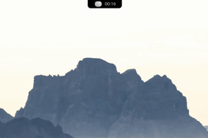

# Aether

A lightweight desktop **island shell for Wayland**, built with Tauri v2, React and
TypeScript, and designed to sit on top of the [labwc](https://labwc.github.io/)
compositor. A single floating island expands into a Spotlight-style launcher, a
clipboard history, a Wi-Fi switcher, a media player and a notification centre —
with **Mochi**, an animated companion, reacting along the way.

[](https://github.com/jeganxthan/aether/actions/workflows/ci.yml)
[](https://jeganxthan.github.io/aether/)
[](LICENSE)
[](#requirements)
[](https://tauri.app/)

<p align="center">
  
</p>

> Status: early / personal project. APIs and layout are still changing.

## Screenshots

**Launcher & clipboard**



**Notifications**


## Features

- **Island UI** — a transparent 28px strip at the top of the screen that expands
  on hover or on demand. The strip reserves its space with a `wlr-layer-shell`
  exclusive zone, so maximized / tiled windows always sit below it and never
  reflow when the island opens.
- **App launcher** — fuzzy search across installed `.desktop` entries, with icons
  and instant launch.
- **Clipboard history** — searchable history backed by SQLite.
- **Wi-Fi switcher** — scan, connect and disconnect networks.
- **Media** — now-playing from any MPRIS player, with album art and transport
  controls.
- **Notification centre** — captures `org.freedesktop.Notifications` and shows a
  live toast in the island, plus a full history.
- **Battery + clock** — status at a glance.
- **Mochi** — an animated canvas companion (ported from
  [Coucou](https://github.com/Louis-CFM/coucou)) that greets, listens, looks at
  the pointer and reflects notification severity.

## Requirements

- Linux with a **Wayland** session running **labwc** (uses `wlr-layer-shell`)
- **Node.js** 18+ and npm
- **Rust** (stable) and Cargo
- System libraries: GTK3, WebKitGTK 4.1, and libwayland dev headers

On Debian/Ubuntu:

```bash
sudo apt install \
  libgtk-3-dev libwebkit2gtk-4.1-dev libwayland-dev libxkbcommon-dev \
  libayatana-appindicator3-dev librsvg2-dev build-essential
```

## Build & run

```bash
git clone https://github.com/jeganxthan/aether.git
cd aether

npm install
npm run tauri dev      # development (Vite + the Tauri window)
npm run tauri build    # production bundle (.deb / AppImage)
```

Compositor integration is required for the island to be positioned and toggled —
see [labwc setup](#labwc-setup).

## labwc setup

Aether is driven from labwc keybinds because hardware global shortcuts are not
reliable under Wayland. Two things are required: the toggle keybinds and a
`windowRule` that pins and positions the widget window. Add both to
`~/.config/labwc/rc.xml`:

```xml
<keybind key="W-space">
  <action name="Execute" command="pkill -USR2 -x aether-tauri"/>
</keybind>
<keybind key="W-c">
  <action name="Execute" command="pkill -WINCH -x aether-tauri"/>
</keybind>
<keybind key="XF86AudioRaiseVolume">
  <action name="Execute" command="pkill -RTMIN+0 -x aether-tauri"/>
</keybind>
<keybind key="XF86AudioLowerVolume">
  <action name="Execute" command="pkill -RTMIN+1 -x aether-tauri"/>
</keybind>
<keybind key="XF86AudioMute">
  <action name="Execute" command="pkill -RTMIN+2 -x aether-tauri"/>
</keybind>
<keybind key="XF86MonBrightnessUp">
  <action name="Execute" command="pkill -RTMIN+3 -x aether-tauri"/>
</keybind>
<keybind key="XF86MonBrightnessDown">
  <action name="Execute" command="pkill -RTMIN+4 -x aether-tauri"/>
</keybind>
```

```xml
<windowRule identifier="*aether*" serverDecoration="no" skipTaskbar="yes"
            skipWindowSwitcher="yes" fixedPosition="yes">
  <action name="ToggleAlwaysOnTop"/>
  <action name="MoveTo" x="680" y="0"/>
</windowRule>
```

Copy-paste-ready files — the config fragment above, a login `autostart` and the
optional Aether theme — with step-by-step instructions live in
[`contrib/labwc/`](contrib/labwc/).

| Shortcut | Action |
| --- | --- |
| `Super` + `Space` | Toggle the app launcher |
| `Super` + `C` | Toggle the clipboard history |
| `Volume` key | Volume OSD (raise) |
| `Volume −` key | Volume OSD (lower) |
| `Mute` key | Volume OSD (mute toggle) |
| `Brightness +` / `−` | Brightness OSD |
| `Escape` / click away | Collapse the island |

> `SIGUSR1` is reserved by WebKitGTK — do not send it to the process.

## Architecture

Aether is two halves:

- **Frontend** (`src/`) — React 19 + Tailwind CSS. The island and every panel
  live here. `src/ui/island/` owns the shell, layout and the Mochi canvas;
  `src/component/*` holds the launcher, clipboard, wifi, music and notification
  surfaces.
- **Backend** (`src-tauri/`) — Rust. Exposes Tauri commands for each panel
  (`src-tauri/src/commands/`) and talks to the system through services
  (`src-tauri/src/services/`): NetworkManager over D-Bus (`zbus`), MPRIS,
  `org.freedesktop.Notifications`, battery sysfs, `.desktop` scanning, and the
  clipboard. `src-tauri/src/space.rs` maps the transparent layer-shell strip;
  `src-tauri/src/focus.rs` restores focus after panels close.

```
src/                React UI (island, panels, Mochi)
src-tauri/src/
  commands/         Tauri command surface (launcher, clipboard, wifi, media, ...)
  services/         System integrations (D-Bus, MPRIS, notifications, wifi)
  models/           Serializable data types
  space.rs          wlr-layer-shell top strip / exclusive zone
  focus.rs          Focus restoration
scripts/            Standalone tsx test scripts
contrib/labwc/      Compositor config (rc.xml fragment, autostart, theme)
```

## Testing

Tests are plain TypeScript scripts run with [`tsx`](https://github.com/privatenumber/tsx)
(no framework):

```bash
npm test                       # runs scripts/popSpring.test.ts
npx tsx scripts/mochiEngine.smoke.ts   # headless Mochi engine smoke test
npx tsc --noEmit               # type-check
cd src-tauri && cargo build    # backend build
```

## Contributing

Contributions are welcome — see [CONTRIBUTING.md](CONTRIBUTING.md) and the
[Code of Conduct](CODE_OF_CONDUCT.md). Good starting points are issues labelled
`good first issue` and `help wanted`.

## License

Released under the [MIT License](LICENSE).

**Exception:** the Mochi character artwork in `src/ui/island/mochi/` is **not**
MIT-licensed — it is used under separate permission and remains the property of
its author. See [THIRD-PARTY-NOTICES.md](THIRD-PARTY-NOTICES.md) for details.
